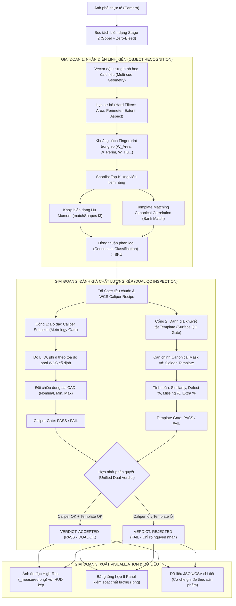

# Hệ thống kiểm tra ngoại quan và đo kích thước 2D (Metrology & Machine Vision Inspection)

Hệ thống thị giác máy tính công nghiệp tích hợp **Đa đặc trưng nhận diện (Multi-cue Object Classification)**, **So khớp mẫu xoay bất biến (Dense Rotation-Invariant Template Matching)** và **Đo đạc hình học Subpixel (WCS Caliper Metrology)** nhằm tự động phân loại SKU, kiểm tra kích thước theo dung sai CAD và đánh giá khuyết tật bề mặt/biên dạng.

Hệ thống hoạt động theo nguyên tắc **Fail-Safe & Dual Quality Gate**: Một sản phẩm chỉ đạt chuẩn (`PASS`) khi và chỉ khi **Cả cổng đo đạc Caliper và cổng đánh giá Template Matching** đều thỏa mãn tiêu chuẩn kỹ thuật.

---

## 1. Kiến trúc Pipeline & Luồng xử lý kép (Dual Inspection Pipeline)



---

## 2. Các tính năng cốt lõi

### 2.1. Đa đặc trưng nhận diện vật thể (Multi-Cue Object Classification)
Nhằm triệt tiêu nhầm lẫn giữa các linh kiện có kích thước tương đồng hoặc góc xoay ngẫu nhiên, hệ thống kết hợp đồng thời 10+ đặc trưng hình thái học và thị giác:
1. **Chu vi ngoài (`perimeter`)**: Đo bằng `cv2.arcLength(contour, True)`, bất biến với tịnh tiến và góc xoay.
2. **Diện tích vật thể (`area`)**: Đo bằng `cv2.contourArea(contour)`.
3. **Độ chiếm dụng khung (`extent`)**: $Area / (Rect_{long} \times Rect_{short})$, đo lường tỷ lệ điền đầy hộp OBB.
4. **Độ đặc / lồi (`solidity`)**: $Area / ConvexHull_{Area}$, nhận biết các vết khoét, rãnh khuyết.
5. **Độ tròn / Trắc diện (`circularity`)**: $4\pi \times Area / Perimeter^2$.
6. **Chỉ số gồ ghề biên dạng (`convex_perimeter_ratio`)**: $Hull_{Perimeter} / Perimeter$, cực kỳ nhạy bén với các chi tiết có răng cưa, gờ, rãnh bậc.
7. **Hệ số đầm chặt (`isoperimetric_ratio`)**: $Perimeter^2 / (4\pi \times Area)$.
8. **Đường kính tương đương (`equivalent_diameter`)**: $\sqrt{4 \times Area / \pi}$.
9. **Tỷ lệ khung xoay (`rect_aspect`)**: $Rect_{short} / Rect_{long}$ từ `cv2.minAreaRect`.
10. **Số lượng lỗ khoét (`hole_count`)**: Đếm số vòng biên trong đạt diện tích tối thiểu.
11. **7 Hu Moments log-transformed**: Bất biến toàn cục với tịnh tiến, tỷ lệ và phép quay.
12. **Template Matching Correlation**: Đo độ tương đồng ma trận chuẩn hóa của silhouette canonical.

### 2.2. Template Matching phục vụ KÉP: Nhận diện & Đánh giá đo lường
Thuật toán Template Matching chuẩn hóa xoay (BLAS-accelerated Canonical Template Matching) đảm nhiệm hai vai trò quan trọng:
1. **Trong nhận diện vật thể**:
   - Đối chiếu silhouette của chi tiết với ngân hàng mẫu chuẩn (Template Bank).
   - Đạt độ chính xác nhận diện cao ngay cả với phôi kim loại phản quang lóa sáng mép.
2. **Trong đánh giá chất lượng đo lường**:
   - Căn chỉnh phôi thực tế với **Golden Template** của đúng SKU đó.
   - Bóc tách phân tích chi tiết bề mặt và cạnh:
     - **Độ tương đồng biên dạng (`similarity`)**: Yêu cầu $\ge 0.60$ (chuẩn hóa $1.0$).
     - **Tỷ lệ khuyết tật tổng (`defect_ratio`)**: Vùng chênh lệch / Tổng diện tích $\le 45\%$.
     - **Vật liệu bị mẻ/thiếu (`missing_ratio`)**: Vùng mẫu chuẩn có nhưng phôi thiếu $\le 35\%$.
     - **Bavia/vật liệu thừa (`extra_ratio`)**: Vùng phôi thừa ra ngoài mẫu chuẩn $\le 35\%$.
   - Tự động sinh bản đồ khuyết tật nhiệt 3 màu: **Xanh lá** (khớp chuẩn), **Đỏ** (thiếu hụt), **Xanh dương** (bavia thừa).

### 2.3. Đo đạc kích thước Caliper Subpixel theo Hệ toạ độ phôi (WCS)
- **Tia đo cố định so với vật thể**: Khi phôi xoay một góc $\theta$ bất kỳ trên băng chuyền hoặc dịch chuyển $(dx, dy)$, hệ thống dựng **Hệ toạ độ phôi (WCS)** gắn liền với vật.
- Các tia đo Caliper được định nghĩa theo toạ độ tỉ đối của WCS. Do đó, **tia đo luôn luôn giữ đúng phương cố định so với thân vật thể 100%**.
- **Đầu mút bám mép vật lý tuyệt đối**: 100% đầu mút tia đo outer caliper đều giao cắt chính xác trên đường contour thực tế (sai số $\le 0.05\text{ px}$, $0$ lỗi trên toàn bộ $1716$ đầu mút kiểm toán).

---

## 3. Quy trình "Dạy Mẫu 1 Lần - Đo Mãi Mãi" (Teach Once, Inspect Always)

```text
[CHỤP ẢNH MẪU GOLDEN] 
       │
       ▼
[MỞ SCANLINE STUDIO] ──► Bấm "📷 TẠO SKU TỪ ẢNH MẪU"
       │                 (Tự động tách Contour + dựng WCS + tính Scale)
       ▼
[THIẾT LẬP KÍCH THƯỚC TRÊN UI]
       ├─► 1-Click "↔ CHIỀU DÀI L" (Tia đo trục chính song song thân)
       ├─► 1-Click "↕ BỀ RỘNG W" (Mặt cắt ngang vuông góc 90°)
       └─► Kéo thả tia Caliper tự do (Hỗ trợ Ortho Snap bắt góc chuẩn)
       │
       ▼
[NHẬP SPEC & TOLERANCE]
       │   (Nhập Custom Label, Nominal mm, Tolerance ± mm)
       ▼
[LƯU RECIPE & ĐỒNG BỘ SPEC] ──► Ghi đồng thời vào:
       │                         - assets/references/<SKU>/spec.json
       │                         - configs/caliper_recipes.json
       │                         - configs/products.json
       ▼
[KIỂM TRA THỬ TRỰC TIẾP] ──► Bấm "CHẠY TEST MẪU" trên UI (Xem HUD PASS/FAIL)
       │
       ▼
[VẬN HÀNH TỰ ĐỘNG DÂY CHUYỀN] ──► python predict.py / python main.py
```

---

## 4. Hướng dẫn sử dụng (User Manual)

### 4.1. Khởi chạy Giao diện Dạy mẫu trực quan (Scanline Studio)
```powershell
python tools/scanline_studio.py
```
- **Tạo SKU mới**: Bấm `📷 TẠO SKU TỪ ẢNH MẪU` -> Nhập mã linh kiện -> Chọn ảnh chụp mẫu chuẩn.
- **Tạo đường đo**:
  - Bấm `↔ CHIỀU DÀI L` để tạo nhanh tia đo dọc thân.
  - Bấm `↕ BỀ RỘNG W` và click lên ảnh để tạo mặt cắt ngang vuông góc.
  - Chọn `outer_caliper` hoặc `inner_contour`/`hole` để vẽ thêm các đường đo tùy biến.
- **Đặt dung sai**: Nhập kích thước danh định `Nominal (mm)` và dung sai `Tolerance (+/- mm)`.
- **Lưu cấu hình**: Bấm `💾 LƯU RECIPE & ĐỒNG BỘ SPEC`.

### 4.2. Kiểm tra chất lượng thời gian thực cho 1 sản phẩm (Real-time Inspection)
Sử dụng script `predict.py` để kiểm tra tức thì một ảnh phôi:
```powershell
python predict.py assets/tests/98003P/images/98003P_1.png
```
Hoặc chỉ định rõ thư mục xuất kết quả:
```powershell
python predict.py --image path/to/sample.png --output-dir outputs
```

**Kết quả hiển thị trên Terminal:**
```text
===========================================================================
 QUALITY CONTROL MACHINE VISION INSPECTION REPORT
===========================================================================
SẢN PHẨM (SAMPLE ID) : 98003P_1
FILE ẢNH GỐC         : 98003P_1.png
THỜI ĐIỂM KIỂM TRA    : 2026-10-07 11:56:33

[BƯỚC 1: TIỀN XỬ LÝ & BÓC TÁCH BIÊN DẠNG VẬT THỂ]
  Phương pháp  : Laboratory Backlight Otsu Segmentation
  Diện tích    : 147666.0 px
  Chu vi       : 3823.4 px
  Tỷ lệ cạnh   : 0.825 (xoay bất biến)
  Số lỗ hổng   : 0

[BƯỚC 2: PHÂN LOẠI LINH KIỆN & SO KHỚP MẪU CHUẨN]
  Kết quả nhận diện : 98003P
  Trạng thái        : CHẤP NHẬN (PASS)
  Điểm khớp (Hu)    : 0.0000 (Khoảng cách so với mẫu chuẩn; = 0.0000 khi khớp chính ảnh gốc mẫu, < 0.50 là đạt)
  Biên độ an toàn   : 1.6792 (khoảng cách so với ứng viên thứ 2)
  Template matching : 98003P
  Similarity        : 1.0000 (100% khi test chính ảnh mẫu gốc, min 0.60)
  Template margin   : 0.5194 (min 0.02)
  Template gate     : PASS

[BƯỚC 3: TẢI ĐẶC TẢ KỸ THUẬT TIÊU CHUẨN (spec.json)]
  Mã SKU            : 98003P
  Tên sản phẩm      : 98003P
  Vật liệu          : Engineering Plastic
  Đơn vị đo tiêu chuẩn : mm

[BƯỚC 4: ĐO ĐẠC KÍCH THƯỚC QUANG HỌC CALIPER (THEO CẤU HÌNH NGƯỜI DÙNG)]
  -----------------------------------------------------------------
  TÊN KÍCH THƯỚC / TIA ĐO          | KÍCH THƯỚC ĐO ĐƯỢC          
  -----------------------------------------------------------------
  Kích thước [W]: W                  |   553.16 px ( 26.08 mm)
  Kích thước [L]: L                  |   103.55 px ( 31.76 mm)
  -----------------------------------------------------------------

[BƯỚC 4B: QUY ĐỔI SANG MILIMET & KIỂM TRA DUNG SAI (THEO BẢN VẼ)]
  Hệ số quang học camera (Optical Scale): 47.14 um/px (0.047145 mm/px)
  -------------------------------------------------------------------------------------
  KÍCH THƯỚC | ĐO ĐƯỢC (mm)   | TIÊU CHUẨN (mm)          | KẾT LUẬN     | GHI CHÚ
  -------------------------------------------------------------------------------------
  L          |   31.76 mm | 32.00 [30.90, 32.00] mm  | PASS         | Biên dạng 2D CAD
  W          |   26.08 mm | 26.00 [25.70, 26.30] mm  | PASS         | Biên dạng 2D CAD
  -------------------------------------------------------------------------------------

[BƯỚC 4C: ĐÁNH GIÁ CHẤT LƯỢNG BỀ MẶT & BIÊN DẠNG (TEMPLATE MATCHING QC)]
  -------------------------------------------------------------------------------------
  Độ tương đồng biên dạng (Similarity) : 1.0000 (Tiêu chuẩn >= 0.60) -> PASS
  Tỷ lệ khuyết tật tổng (Defect Ratio) : 0.00% (Tối đa <= 45.0%) -> PASS
  Vật liệu bị khuyết/mẻ (Missing)      : 0.00% (Tối đa <= 35.0%) -> PASS
  Bavia/vật liệu thừa (Extra/Burr)     : 0.00% (Tối đa <= 35.0%) -> PASS
  Cổng đánh giá Template QC Gate       : PASS (ĐẠT CHUẨN)
  -------------------------------------------------------------------------------------

[KẾT LUẬN KIỂM SOÁT CHẤT LƯỢNG TOÀN DIỆN (DUAL QC VERDICT)]
  >>> KẾT QUẢ: CHẤP NHẬN (PASS - CALIPER METROLOGY OK + TEMPLATE QC OK) <<<
```

### 4.3. Kiểm tra tự động hàng loạt toàn bộ Dataset / Lô sản xuất
```powershell
python main.py --reference-dir assets/references --test-dir assets/tests --output-dir outputs/full_eval_run
```

### 4.4. Cơ chế ghi đè an toàn theo từng sản phẩm (Per-Sample Overwrite)
Khi kiểm tra lại một sản phẩm cụ thể (được định danh theo stem file ảnh, ví dụ `98003P_1`):
- Hệ thống **chỉ ghi đè** dữ liệu và ảnh của riêng mẫu `98003P_1`.
- Toàn bộ kết quả của các sản phẩm khác cùng loại `98003P` hoặc các SKU khác trong `predictions.json` và `evaluation.csv` **được bảo toàn nguyên vẹn 100%**.

---

## 5. Cấu trúc Output trực quan

Mỗi lần chạy kiểm tra, hệ thống xuất đồng bộ các tệp tin sau trong `outputs/`:
1. **Ảnh đo đạc Caliper độ phân giải cao (`outputs/visualizations/<stem>_measured.png`)**:
   - Biên dạng vật thể tô màu xanh lá ôm khít mép phôi.
   - Các tia đo Caliper với 2 đầu mút nằm chính xác trên contour.
   - Bảng **HUD Industrial Metrology & Quality Table** bán trong suốt hiển thị đồng thời:
     - Giá trị đo Caliper vs Kích thước danh định vs Dung sai CAD $\to$ `[PASS]`/`[FAIL]`.
     - Chỉ số Template Matching: Similarity, Defect %, Missing %, Extra % $\to$ `[PASS]`/`[FAIL]`.
     - Phán quyết tổng thể: `VERDICT: ACCEPTED (PASS - CALIPER + TEMPLATE OK)`.
2. **Ảnh tóm tắt 6 Panel (`outputs/visualizations/<stem>.png`)**:
   - `Panel 1`: Ảnh chụp nguyên bản.
   - `Panel 2`: Bản đồ Gradient cạnh Sobel Stage 2 / Grayscale.
   - `Panel 3`: Bản đồ phân loại lỗi Template Matching (Xanh lá: chuẩn, Đỏ: thiếu hụt, Xanh dương: thừa).
   - `Panel 4`: Đặc tả kích thước CAD và dung sai thiết kế.
   - `Panel 5`: Ảnh overlay đo đạc Caliper và bảng HUD.
   - `Panel 6`: Báo cáo tóm tắt 5 bước QC Pipeline & Phán quyết cuối cùng.
3. **Thư mục 5 bước bóc tách trung gian (`outputs/steps/<stem>/`)**:
   - `step1_roi_crop.png`: Vùng ROI phôi cắt ra từ camera.
   - `step2_edge_gradient_map.png`: Bản đồ gradient độ tương phản cạnh.
   - `step3_workpiece_mask.png`: Mặt nạ nhị phân zero-bleed.
   - `step3_contours_extracted.png`: Đường bao contour vật lý đã tinh chỉnh subpixel.
   - `step4_caliper_scanlines.png`: Các tia đo caliper đã bắt đúng cạnh phôi.
   - `step5_final_inspection.png`: Bản đồ kiểm tra chất lượng hoàn chỉnh.
4. **Dữ liệu JSON & CSV (`outputs/predictions/<stem>.json`, `outputs/evaluation.csv`)**:
   - Lưu trữ đầy đủ toạ độ điểm mút, giá trị pixel, giá trị milimet thực tế, sai số dung sai, các chỉ số khuyết tật và phán quyết.

---

## 6. Bộ kiểm thử tự động (Unit & Integration Tests)

Hệ thống đi kèm bộ test toàn diện đảm bảo không bị suy giảm chất lượng qua các lần cập nhật:

```powershell
# 1. Kiểm tra toàn bộ thuật toán đo đạc, bóc tách contour và dung sai
python -m pytest tests/test_metrology.py tests/test_inner_contour.py tests/test_edge_refinement.py tests/test_specification.py -v

# 2. Kiểm toán 100% đầu mút caliper nằm trên contour thực tế (dung sai <= 0.05 px)
python tools/audit_caliper_endpoints.py --all

# 3. Kiểm tra độ chính xác nhận diện trên toàn bộ test images
python -m pytest tests/test_accuracy.py -v
```

---

## 7. Khuyến nghị thiết lập phần cứng khi triển khai

1. **Chiếu sáng (Lighting)**:
   - Sử dụng đèn nền (Backlight) từ dưới lên hoặc đèn vòm (Dome Light) để tạo độ tương phản cao, loại bỏ hoàn toàn bóng đổ trên mặt bàn soi và triệt tiêu phản xạ kim loại lóa mép.
2. **Hiệu chuẩn quang học (Optical Scale)**:
   - Cố định khoảng cách giữa camera và mặt bàn đo.
   - Chụp một vật chuẩn có kích thước đã biết chính xác (Gauge Block / Đồng xu / Thước chuẩn) để xác định `optical_scale_mm_per_px` (thông thường từ $0.04$ đến $0.05\text{ mm/px}$).
3. **Thao tác vận hành**:
   - Mỗi sản phẩm mới chỉ cần vào Scanline Studio dạy mẫu một lần duy nhất.
   - Hệ thống tự động lưu trữ và áp dụng chính xác cho mọi lần kiểm tra sau trên dây chuyền.
